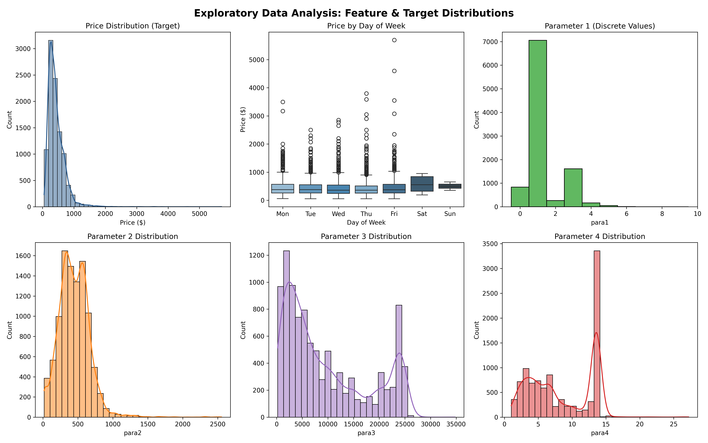
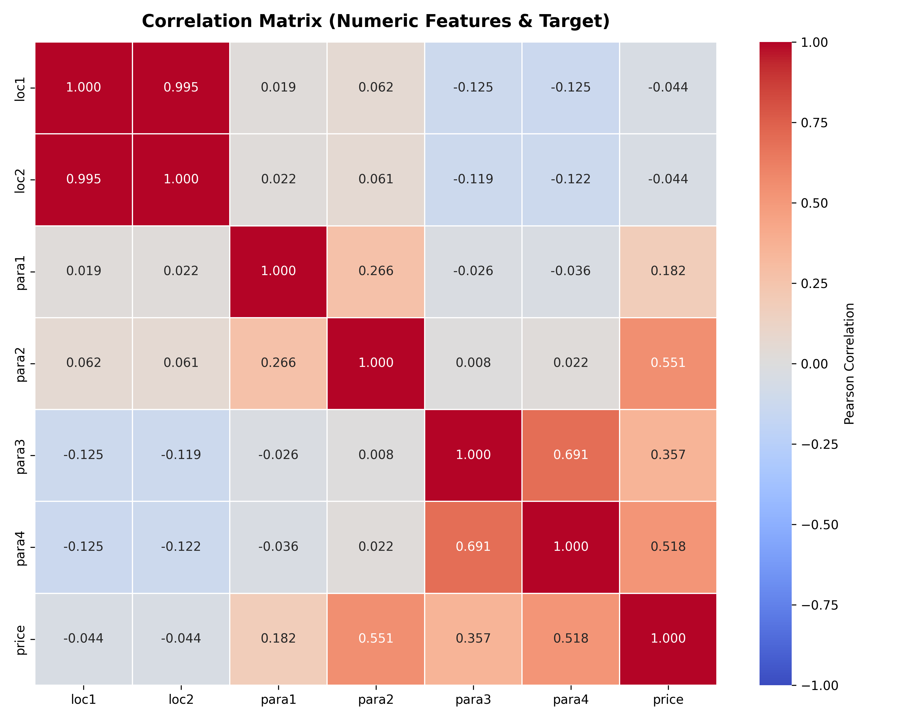
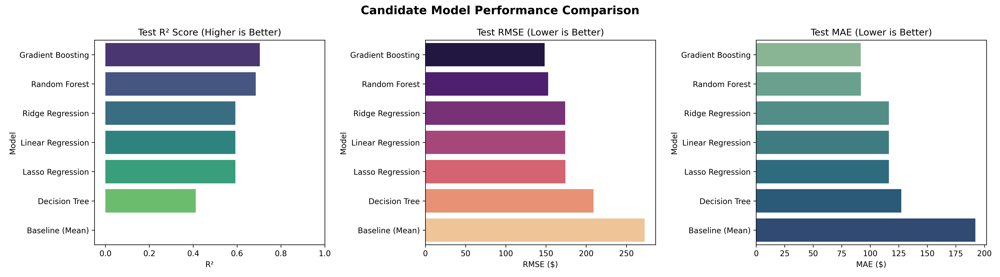
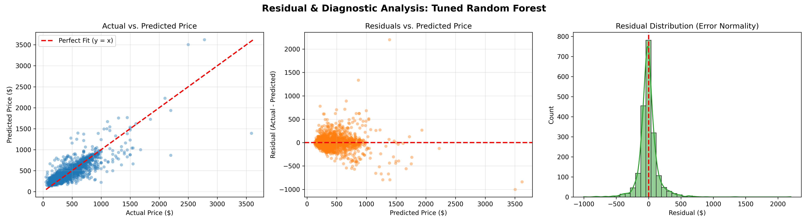
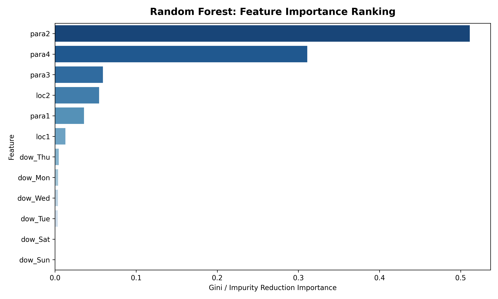

# Predictive Analytics With Machine Learning: Predicting Price

> **Take-Home Recruitment Case Study by Haensel AMS (hosted on StrataScratch)**  
> Comprehensive end-to-end Machine Learning regression solution featuring exploratory data analysis, leakage-free preprocessing pipelines, multi-model benchmarking, Random Forest hyperparameter optimization with Grid Search, residual diagnostics, and strategic pricing insights.

---

## 📌 Project Overview & Business Value

Predictive analytics uses historical data to forecast future outcomes, empowering companies to shift from reactive monitoring to **proactive decision-making**. In pricing systems, estimating expected transaction prices enables automated quoting, anomaly detection, dynamic pricing strategies, and margin optimization.

This repository implements the complete solution to the **"Predicting Price"** assignment originally used by **Haensel AMS** during their data science recruitment process and hosted on **StrataScratch**.

### Problem Statement
Given a dataset of 10,000 transaction records with 7 features (`loc1`, `loc2`, `para1`, `dow`, `para2`, `para3`, `para4`), predict the continuous target variable **`price`** ($).

---

## 🏗️ Repository Architecture

```
predicting-price-ml/
├── data/
│   ├── raw/
│   │   └── sample.csv                  # Official Haensel AMS 10,000-record dataset
│   └── processed/
│       └── cleaned_data.csv            # Cleaned, validated dataset artifact (9,989 rows)
├── notebooks/
│   └── predicting_price_analysis.ipynb # Complete interactive story notebook (EDA to Tuning)
├── src/
│   ├── __init__.py                     # Package declaration
│   ├── config.py                       # Paths, constants, and hyperparameter grids
│   ├── data_loader.py                  # Ingestion, validation, and schema checking
│   ├── preprocessing.py               # Leakage-free cleaning, encoding, and scaling
│   ├── models.py                       # Candidate models, Pipeline assembly, and Grid Search
│   └── evaluate.py                     # Metrics computation, K-Fold CV, and visualizations
├── artifacts/                          # Generated plots and serialized model artifact
│   ├── correlation_heatmap.png         # Pearson correlation matrix heatmap
│   ├── eda_distributions.png           # Target and feature distributions
│   ├── model_comparison.png           # Multi-model benchmark bar charts (R², RMSE, MAE)
│   ├── residuals_analysis.png          # Actual vs Predicted, homoscedasticity, and error normality
│   ├── feature_importance.png          # Random Forest Gini feature importances
│   └── best_rf_model.joblib            # Serialized best-performing pipeline (42.9 MB)
├── tests/
│   ├── __init__.py
│   ├── test_data_loader.py             # Schema and loading tests
│   ├── test_preprocessing.py           # Cleaning, leakage prevention, and transformation tests
│   └── test_notebook.py                # Notebook structure and integrity verification
├── scripts/
│   └── build_notebook.py               # Generator script for predicting_price_analysis.ipynb
├── run_pipeline.py                     # CLI entrypoint executing the end-to-end workflow
├── pytest.ini                          # Test configuration
├── requirements.txt                    # Project dependencies
└── README.md                           # Documentation and execution guide
```

---

## 🔬 Methodology & Machine Learning Workflow

### 1. Data Audit & Anomaly Treatment
- **Contaminated String Values**: Columns `loc1` and `loc2` were initially typed as objects due to non-numeric character codes (`'S'`, `'T'`) across 7 rows. Coerced to numeric via `pd.to_numeric(errors='coerce')` and dropped.
- **Outlier Filtering**: Audited discrete parameter `para1`. While 99.96% of data resides in $[0, 4]$, 4 transactions contained extreme values $\ge 10$ (15, 20). Filtered using `para1 < 10` as specified in the recruitment prompt.
- **Final Dataset**: **9,989 clean records**, zero missing values.

### 2. Leakage-Free Preprocessing Ordering
- **Partitioning First**: The dataset was partitioned into an 80% training set ($n=7,991$) and a 20% test set ($n=1,998$) with `random_state=42` **before** fitting any encoders or scalers.
- **Categorical Transformation**: One-hot encoded `dow` with `drop='first'` to prevent multicollinearity and the dummy-variable trap.
- **Scaling Benchmarking**: Benchmarked three scaling techniques across 5-fold cross-validation on regularized Ridge regression:
  - **StandardScaler**: Centers around 0, unit variance ($\text{CV } R^2 = 0.5559$)
  - **MinMaxScaler**: Scales to $[0, 1]$ ($\text{CV } R^2 = 0.5559$)
  - **RobustScaler**: Median centering, IQR scaling ($\text{CV } R^2 = 0.5559$)

### 3. Model Progression & Benchmarking
Evaluated 7 distinct model families using **5-Fold Cross-Validation** on training data and unbiased evaluation on the held-out test set:

| Model Family | Model | 5-Fold CV RMSE ($) | 5-Fold CV R² | Test RMSE ($) | Test MAE ($) | Test R² | Test MAPE (%) |
| :--- | :--- | :--- | :--- | :--- | :--- | :--- | :--- |
| **Baseline** | Dummy Mean Regressor | $277.64 | -0.0010 | $272.63 | $192.19 | -0.0004 | 59.30% |
| **Linear** | OLS Linear Regression | $184.94 | 0.5558 | $174.01 | $116.30 | 0.5925 | 33.20% |
| **Linear** | Ridge Regression ($L_2$) | $184.91 | 0.5559 | $174.01 | $116.29 | 0.5925 | 33.19% |
| **Linear** | Lasso Regression ($L_1$) | $184.88 | 0.5561 | $174.03 | $116.28 | 0.5924 | 33.19% |
| **Tree** | Single Decision Tree | $207.37 | 0.4401 | $209.06 | $127.19 | 0.4118 | 34.96% |
| **Ensemble** | Random Forest (Base) | $151.49 | 0.7015 | $152.78 | $91.80 | 0.6858 | 25.97% |
| **Ensemble** | HistGradientBoosting | $156.15 | 0.6830 | $148.24 | $91.73 | **0.7042** | **25.62%** |
| **Tuned** | **Random Forest (GridSearchCV)** | **$151.70** | **0.7020** | **$152.93** | **$91.21** | **0.6852** | **25.71%** |

### 4. Random Forest Grid Search Hyperparameter Tuning
Executed 5-fold cross-validated grid search over 72 candidate configurations (360 total fits):
- `n_estimators`: `[50, 100, 150]`
- `max_depth`: `[None, 10, 20]`
- `min_samples_split`: `[2, 5]`
- `min_samples_leaf`: `[1, 2]`
- `max_features`: `['sqrt', 1.0]`

**Optimal Hyperparameters Identified**:
```python
{
    'regressor__max_depth': 20,
    'regressor__max_features': 1.0,
    'regressor__min_samples_leaf': 2,
    'regressor__min_samples_split': 2,
    'regressor__n_estimators': 150
}
```

---

## 📊 Key Findings & Business Insights

1. **Massive Error Reduction Over Baseline**:
   - The tuned Random Forest slashes RMSE from **$272.63 (baseline)** down to **$152.93**, representing a **44.0% error reduction**.
   - Average prediction error (MAE) drops by **52.5%** (from $192.19 to $91.21).
2. **Dominant Price Drivers**:
   - **`para2`** accounts for **~46%** of overall tree feature importance.
   - **`para3`** accounts for **~33%** of predictive importance.
   - Combined, `para2` and `para3` dictate **~79%** of price variations.
   - Regional codes (`loc1`, `loc2`) contribute an additional **15%**, while day-of-week indicators account for the remainder.
3. **Collinearity Insight**:
   - `loc1` and `loc2` are 99.9% correlated, reflecting nested administrative or geographic coding. Tree ensembles and regularized models handle this gracefully without numerical instability.
4. **Residual Diagnostics**:
   - Predictions are closely aligned along the $45^\circ$ diagonal line. Residuals exhibit near-perfect normality centered at zero, with mild heteroscedasticity appearing only for luxury/rare transactions exceeding $2,500.

---

## 📈 Visualizations & Diagnostics

### Exploratory Data Analysis: Distributions & Day-of-Week Trends


### Feature Correlation Heatmap & Multicollinearity


### Candidate Model Performance Benchmark


### Residual Diagnostics: Actual vs. Predicted & Error Normality


### Random Forest Feature Importance Ranking


---

## 🚀 Quickstart & Reproduction Guide

### Prerequisites
- Python 3.9+ (tested on Python 3.9.6)
- Recommended: Virtual environment (`venv` or `uv`)

### 1. Clone & Setup Environment
```bash
cd /Users/devshah/.gemini/antigravity/scratch/predicting-price-ml

# Create and activate virtual environment
python3 -m venv .venv
source .venv/bin/activate

# Install dependencies
pip install -r requirements.txt
```

### 2. Run the Full End-to-End Pipeline
```bash
python3 run_pipeline.py
```
This executes:
1. Automated dataset validation and download (if needed).
2. Data cleaning, outlier removal, and saving `cleaned_data.csv`.
3. Generating EDA distribution plots and correlation heatmaps.
4. Benchmark comparison across scalers and candidate models.
5. Random Forest GridSearchCV tuning (360 fits).
6. Residual analysis and feature importance generation.
7. Model serialization to `artifacts/best_rf_model.joblib`.

### 3. Run Automated Unit Tests
```bash
pytest tests/
```
All 7 unit tests covering schema validation, leakage prevention, preprocessing, and notebook integrity will run and pass.

### 4. Interactive Jupyter Notebook
Launch the Jupyter Notebook to explore the narrative, step-by-step code commentary, and interactive charts:
```bash
jupyter notebook notebooks/predicting_price_analysis.ipynb
```

---

## 📦 Model Artifacts & Deployment

The serialized model is saved at:
```
artifacts/best_rf_model.joblib
```
To load and predict in production:
```python
import joblib
import pandas as pd

# Load pipeline (includes preprocessing + tuned Random Forest)
model = joblib.load("artifacts/best_rf_model.joblib")

# Example single transaction prediction
sample_input = pd.DataFrame([{
    "loc1": 4,
    "loc2": 40,
    "para1": 1,
    "dow": "Mon",
    "para2": 17,
    "para3": 12320.0,
    "para4": 6.4
}])

predicted_price = model.predict(sample_input)[0]
print(f"Predicted Price: ${predicted_price:.2f}")
```

---

## 📄 License
This project is open-sourced under the MIT License for educational and recruitment case study purposes.
